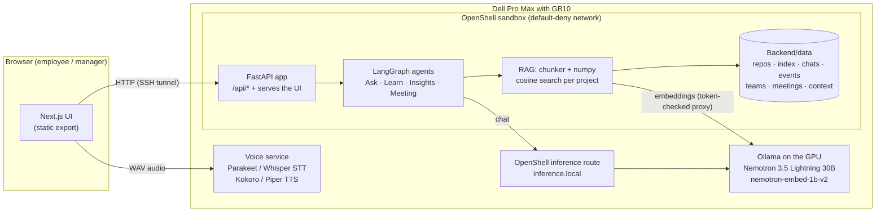

# OnBoardAI

**An onboarding assistant for new developers that knows your codebase, and runs entirely on a Dell Pro Max with GB10. Your source code and your meetings never leave the building.**

---

## 🏆 Built at the Dell x NVIDIA AI Hackathon, Boston

OnBoardAI was built at the **Dell x NVIDIA AI Hackathon in Boston on Saturday, 3 October 2026**: the Boston stop of the Dell x NVIDIA tour, hosted on [BuilderBase](https://builderbase.com), under the theme **"Local AI on the Dell Pro Max with GB10."**

The brief: in **one day (eight hours)**, go from a blank repo to a working, always-on business agent that you would actually deploy at work, running **100% locally on the Dell Pro Max with GB10**. No cloud, and no prompt-engineering demos. About 150 builders took part, and the top teams pitched live to the judging panel.

We picked a problem every software company has: **onboarding new engineers.**

---

## Contents

- [The problem](#the-problem)
- [What OnBoardAI does](#what-onboardai-does)
- [Why it has to be local](#why-it-has-to-be-local)
- [Architecture](#architecture)
- [The agents](#the-agents)
- [Models on the GB10](#models-on-the-gb10)
- [Tech stack](#tech-stack)
- [Repository layout](#repository-layout)
- [Getting started](#getting-started)
- [Deploying to the GB10](#deploying-to-the-gb10)
- [API overview](#api-overview)
- [Data, privacy and security](#data-privacy-and-security)
- [Limitations and next steps](#limitations-and-next-steps)
- [Team](#team)

---

## The problem

New developers usually get onboarded the same way: a pile of docs that are half out of date, a busy manager, and a lot of "sorry, quick question." It takes weeks before they're really productive, and many new hires leave within their first few months.

Two things make it worse:

- **The knowledge lives in the code, not the docs.** New hires need answers about *this* codebase: where something is implemented, how a request flows, what breaks if they change a file.
- **They can't paste company code into a public chatbot.** Source code, internal docs and meeting notes are confidential.

Managers have the opposite problem: they can't see who is struggling until it's too late, or which parts of the documentation confuse everyone.

## What OnBoardAI does

OnBoardAI has two portals, each with its own login, and a shared team space.

### Employee portal

| Feature | What it does |
| --- | --- |
| **Chat with your codebase** | Ask anything about your team's repositories. An agent searches the actual code and docs, reads the files it needs, and answers with **file and line citations**. Click a citation to see the exact lines. |
| **Honest when it doesn't know** | If the code and docs don't cover a question, it says so instead of guessing, and **flags a documentation gap** for the manager. |
| **Conversation threads** | ChatGPT/Claude-style history: **New chat**, past conversations in a sidebar grouped by date, and per-thread context, so follow-up questions work. |
| **Files** | Browse the repositories your teams have access to, with line numbers. |
| **Learn** | Interactive learning on real project material: OnBoardAI writes questions about the code itself ("what does this function do", "where would you change this", "what breaks if…"), grades your answer against the source, shows the citation, and re-teaches what you missed. |
| **Experience** | Quick feedback on how onboarding is going (rating, what made sense, what was confusing). |

### Manager portal

| Feature | What it does |
| --- | --- |
| **Dashboard** | Team analytics: progress per employee, learning scores, questions asked and left unanswered, onboarding milestones (first ticket, first merged PR), and **at-risk flags** (low scores, inactivity, repeatedly asking about the same topic). |
| **Docs to improve** | The documentation sections that keep causing unanswered questions and wrong answers. |
| **AI report** | One click generates a written report: summary, who's at risk and why, concrete doc fixes, and recommended actions. |
| **Teams** | Each manager's teams, their members, and each team's projects. For every project the manager can **add context** (paste notes or upload text files): conventions, ownership, how to deploy. The chat agent then cites it. |
| **Projects** | **Connect a repository** (Git URL or local path, branch, optional access token) and give a team access. It is cloned, chunked and indexed for chat, Files and Learn. |

### Team space

| Feature | What it does |
| --- | --- |
| **Meeting minutes** | Paste or upload a meeting transcript and get structured minutes: summary, decisions, action items with owners and due dates, notes and open questions. Minutes are saved and indexed, so the chat agent can answer questions about past meetings. |
| **Voice** | A speech service on the GB10 host (see [Models](#models-on-the-gb10)) does speech-to-text and text-to-speech, including Hindi/English (Hinglish) transcription with Whisper. The browser calls it directly; the backend never handles audio. |

## Why it has to be local

- **Source code and internal meetings are confidential.** Every model, from chat to embeddings to speech, runs on the GB10's GPU and CPU. Nothing is sent to a cloud API.
- **The agent is locked down.** In production OnBoardAI runs inside an **NVIDIA OpenShell sandbox** with a **default-deny network policy**: it can reach the local inference route and the local embeddings endpoint, and nothing else. `curl https://github.com` from inside the sandbox fails with `403`.
- **One box.** The Dell Pro Max with GB10 (128 GB unified memory) holds a 30B chat model, an embedding model, speech models and the app at the same time.

## Architecture



**How a question gets answered:**

1. The employee asks a question in a chat thread. The backend works out which projects the employee can see (through their teams).
2. The **Ask Agent** always starts with a semantic search on the question over the project's code, docs, the manager's context and meeting minutes.
3. In a LangGraph tool loop (up to 4 tool rounds), the model can search again, **read specific lines of a file**, or **flag a documentation gap**.
4. The answer must come from tool results and cite `path:start-end`. Citations come back as structured chunks that the UI shows as clickable chips.
5. The turn is saved to the conversation thread, and a `chat_question` (or `chat_unanswered`) event feeds the manager analytics.

## The agents

All agents are LangGraph graphs whose nodes call the local model through the OpenAI-compatible client (`Backend/app/core/llm.py`). No `langchain-openai`, no cloud SDKs.

| Agent | Where | How it works |
| --- | --- | --- |
| **Ask Agent** | `Backend/app/agents/ask_agent.py` | LangGraph tool loop with `search_knowledge`, `read_file` and `flag_doc_gap`; max 4 tool rounds; answers only from tool results with path and line citations; per-conversation memory (last 10 turns); falls back to the best search hits if the model is unreachable. |
| **Learn** | `Backend/app/learn/service.py` | Selects material (a file, a topic or the onboarding catalog), generates questions that fit the content type (code vs docs), grades each answer against the source chunk with reasoning on, returns feedback, gap concepts and a citation, and logs `learn_attempt` events. |
| **Insights / report** | `Backend/app/analytics/service.py` | Turns the team's analytics (scores, inactivity, repeated topics, doc gaps, milestones) into a manager report. |
| **Meeting Minutes** | `Backend/app/agents/meeting_agent.py` | One structured `chat_json` call with reasoning on; long transcripts are map-reduced (parts condensed quickly, then merged). |

**Fast vs careful reasoning.** Nemotron 3.5 Lightning is a reasoning model. We measured that `reasoning_effort: "none"` on Ollama's OpenAI endpoint skips the hidden reasoning pass (**0.2 s and 11 tokens instead of 2.6 s and 264 tokens** on a simple question), while Ollama's native `think: false` is ignored there. Chat uses fast mode by default; grading and reports use full reasoning.

**Retrieval.** Code is chunked by top-level function or class (or 60-line windows) with line numbers; Markdown is chunked by headings. Binaries, lockfiles, vendored folders and files over 200 KB are skipped. Chunks are embedded with `nemotron-embed-1b-v2` (using its `query: ` / `passage: ` prefixes), stored per project as normalized numpy arrays, and searched with cosine similarity scoped to the projects the employee can access.

## Models on the GB10

| Role | Model | Runs via |
| --- | --- | --- |
| Chat and agents (main) | **Nemotron 3.5 Lightning 30B** (`nemotron-3.5-lightning:30b`) | Ollama on the GPU, through the OpenShell inference route |
| Chat (backup) | Qwen3.6 35B-A3B (`qwen3.6:35b-a3b`) | Ollama |
| Small/fast model | Nemotron 3 Nano 4B (`nemotron-3-nano:4b`) | Ollama |
| Embeddings (main) | **NVIDIA llama-nemotron-embed-1b-v2** (2048 dims) | Ollama `/api/embed` through a token-checked proxy |
| Embeddings (backup) | bge-m3 | Ollama |
| Speech-to-text | NVIDIA **Parakeet TDT 0.6B v3** (English), **Whisper large-v3-turbo** (Hindi/English and other languages) | sherpa-onnx on the GB10 |
| Text-to-speech | **Kokoro** (11 English voices), **Piper** (amy, lessac) | sherpa-onnx on the GB10 |

## Tech stack

- **Hardware:** Dell Pro Max with NVIDIA GB10 (DGX OS 7 / Ubuntu 24.04, aarch64, 128 GB unified memory)
- **Isolation:** NVIDIA OpenShell sandbox with a default-deny network policy
- **Inference:** Ollama (local), reached through OpenShell's inference route
- **Backend:** Python 3.13, FastAPI, LangGraph, the OpenAI client, numpy, httpx, pydantic. These are the **only** Python packages the backend uses, because they are the ones available offline on the GB10 (pinned in `Backend/requirements-app.txt`). Git is used through the `git` CLI.
- **Frontend:** Next.js 15, React 19, Tailwind CSS, shadcn/ui, exported as static files and served by the FastAPI app
- **Speech:** sherpa-onnx (Parakeet, Whisper, Kokoro, Piper)
- **Storage:** plain JSON/JSONL files and numpy arrays under `Backend/data` (no database needed for OnBoardAI)

## Repository layout

```
.
├── Backend/
│   ├── app/                      # OnBoardAI backend (FastAPI)
│   │   ├── main.py               # mounts every router under /api, serves the built UI at /
│   │   ├── core/                 # llm, embed, auth, chats, events, store, config
│   │   ├── rag/                  # ingest (chunking), index (embeddings), search, files
│   │   ├── agents/               # ask_agent, learn_agent, insights_agent, meeting_agent
│   │   ├── learn/                # interactive learning sessions
│   │   ├── analytics/            # metrics, at-risk rules, fake-data loading
│   │   ├── team/                 # meeting storage
│   │   └── routers/              # auth, chat, files, projects, teams, learn, feedback, analytics, team, admin
│   ├── data/                     # employees, teams, users (hashed passwords), demo history, projects
│   ├── requirements-app.txt      # the 8 allowed Python packages
│   └── app.py, routes/, services/  # legacy Flask stack this project started from
├── Frontend/
│   ├── app/
│   │   ├── page.tsx, login/      # landing page with Employee / Manager login
│   │   ├── employee/             # chat, files, learn, experience
│   │   ├── manager/              # dashboard, teams, projects
│   │   └── team/meetings/        # meeting minutes
│   ├── components/shell/         # portal shell, role-based navigation, session
│   └── src/lib/api.ts            # typed API client
├── CONTRACTS.md                  # interfaces between the three workstreams
├── deploy.sh                     # one-command deploy into the GB10 sandbox
└── .env.example
```

## Getting started

### Prerequisites

- Access to a GB10 (or any machine running Ollama with the models above)
- Node.js 20+ and [uv](https://docs.astral.sh/uv/) (or Python 3.13)

### 1. Open the tunnel to the GB10

The model, embeddings and voice service run on the GB10. From your laptop:

```bash
ssh -N -L 21434:127.0.0.1:11434 -L 8100:127.0.0.1:8100 -L 18000:127.0.0.1:8000 <user>@<gb10-ip>
```

| Local port | GB10 service |
| --- | --- |
| 21434 | Ollama: chat (`/v1`) and embeddings (`/api/embed`) |
| 8100 | Voice service (STT/TTS), called by the browser only |
| 18000 | OnBoardAI running in the GB10 sandbox |

### 2. Run the backend and build the UI

```bash
cp .env.example .env            # defaults point at the tunnel
npm run setup:app               # Backend/.venv-app with only the allowed packages
npm run build:web               # static UI in Frontend/out
npm run dev:app                 # http://localhost:8001 (API under /api, UI at /)
```

For frontend work with hot reload: `cd Frontend && NEXT_PUBLIC_API_BASE=http://localhost:8001 npm run dev`.

### 3. Connect a repository

Sign in as a manager, open **Projects**, and connect a repository (a Git URL or a local path) for one of your teams. OnBoardAI clones it (`git clone --depth 1`), chunks and embeds it, and the team's employees can start asking about it.

### Demo accounts

| Portal | Email | Password |
| --- | --- | --- |
| Manager | `dana@onboardai.dev` or `rahul@onboardai.dev` | `manager123` |
| Employee | `alex@onboardai.dev` (or any employee's email in `Backend/data/users.json`) | `employee123` |

Each account can only sign in through its own portal's login.

## Deploying to the GB10

```bash
./deploy.sh
```

`deploy.sh` builds the UI, stages the code, data and prebuilt indexes, uploads them into the GB10's OpenShell sandbox, installs dependencies **offline** from the bundled wheels, writes the production `.env` (inference route + token-checked embeddings proxy), starts uvicorn in a `tmux` session on `127.0.0.1:8000`, keeps the OpenShell port forward up, and runs a health check.

- Code and the static build are replaced on every deploy; **data created on the GB10** (chat threads, events, manager context, meetings, repositories added in the UI) is kept.
- The embeddings proxy token stays in the sandbox environment and is never written to disk.
- The sandbox can't reach GitHub, so repositories are cloned and indexed before upload (or added from a local path).

## API overview

All endpoints are under `/api`.

| Area | Endpoints |
| --- | --- |
| Auth | `POST /auth/login`, `GET /auth/me` |
| Chat | `POST /chat`, `GET /chat/conversations`, `GET\|DELETE /chat/conversations/{id}`, `GET /chat/history` |
| Files | `GET /files?project_id=`, `GET /files/content?project_id=&path=` |
| Projects | `GET /projects`, `POST /projects`, `POST /projects/{id}/members`, `GET\|POST /projects/{id}/context`, `GET /projects/{id}/context/{name}` |
| Teams | `GET /teams` (manager), `POST /teams`, `POST /teams/{id}/projects`, `GET /my/teams` (employee) |
| Learn | `GET /learn/topics`, `POST /learn/start`, `POST /learn/answer` |
| Feedback | `POST /feedback/experience`, `GET /feedback/experience` |
| Analytics | `GET /analytics/overview`, `GET /analytics/employee/{id}`, `GET /analytics/doc-gaps`, `GET /analytics/report` |
| Team | `POST /team/summarize`, `GET /team/meetings`, `GET /team/meetings/{id}` |
| Admin | `GET /health`, `GET /employees`, `POST /admin/reindex` |

The full interface between the workstreams (agent signatures, data shapes, events) is in [`CONTRACTS.md`](CONTRACTS.md).

## Data, privacy and security

- **No cloud calls.** Chat, embeddings and speech all run on the GB10.
- **Sandboxed.** The production app runs inside an OpenShell sandbox whose network policy only allows the local inference route and the embeddings endpoint.
- **Passwords** are stored as PBKDF2-SHA256 hashes; sessions use HMAC-signed tokens.
- **Repository tokens** (for private repos) are used only inside the clone URL. They are removed from the stored remote and from error messages, and never sent to the model.
- **Employee chats are private.** Managers see aggregate analytics and documentation gaps, not employees' conversations.
- **Runtime data** (cloned repos, indexes, chats, events, uploaded context) is gitignored.

## Limitations and next steps

- **Voice:** the GB10 voice service (STT/TTS) runs next to Ollama on the host and wraps the bundle's sherpa-onnx voice kit; its code isn't part of this repository yet. The hands-free voice mode built on it lives in the older UI; wiring the recorder into the new chat input bar (`components/voice/VoiceButton.tsx`) is next.
- **Git from the sandbox:** the sandbox blocks GitHub, so repos are cloned on the host or a laptop first. Next: a sandbox policy that allows only the `git` binary to reach the company's Git server, plus incremental re-indexing on sync.
- **Context uploads** accept text files (Markdown, text, code); PDF parsing isn't available with the offline package set.
- **Demo data:** analytics on the manager dashboard use generated onboarding history for a 14-person team.
- **Legacy code:** `Backend/app.py`, `Backend/routes/` and the older Flask-based pages come from the project we started from and aren't used by OnBoardAI.

## Team

Built in one day at the Dell x NVIDIA AI Hackathon, Boston, by:

- **Aatmaj Salunke**
- **Vijwal Mahendrakar**
- **Tanvi Deshpande**
- **Yaksh Shah**

Thanks to **Dell Technologies**, **NVIDIA** and **BuilderBase** for the hardware, the event and a great day of building.
